## Miuix

A UI library for Compose Multiplatform.

> This library is experimental. APIs may change without notice.

[](https://kotlinlang.org/)
[](https://kotlinlang.org/compose-multiplatform/)
[](https://search.maven.org/search?q=g:top.yukonga.miuix.kmp)
[](LICENSE)

### Supported Platforms


### Demos

[](https://compose-miuix-ui.github.io/miuix-wasmJs/)
[](https://github.com/compose-miuix-ui/miuix/actions/workflows/example.yml)

### Modules

| Module              | Description                                                |
| ------------------- | ---------------------------------------------------------- |
| `miuix-ui`          | Core UI component library                                  |
| `miuix-preference`  | Preference components library, depends on `miuix-ui`       |
| `miuix-icons-symbol` | Built-in variable symbol icon library, can be used independently |
| `miuix-material`    | Render primitives and material definitions                 |
| `miuix-blur`        | Blur effect library, can be used independently             |
| `miuix-squircle`    | Squircle shapes library, can be used independently         |
| `miuix-glass`       | Glass surfaces and components library                      |
| `miuix-nav`         | Navigation library, can be used independently              |
| `miuix-window`      | Desktop window & caption bar styling library (Desktop JVM) |

### Getting Started

```diff
kotlin {
    sourceSets {
        commonMain.dependencies {
+           implementation("top.yukonga.miuix.kmp:miuix-ui:<version>")
            // Optional: Add miuix-preference for preference components
            implementation("top.yukonga.miuix.kmp:miuix-preference:<version>")
            // Optional: Add miuix-icons-symbol for the variable Symbol icon set
            implementation("top.yukonga.miuix.kmp:miuix-icons-symbol:<version>")
            // Optional: Add miuix-blur for blur effects
            implementation("top.yukonga.miuix.kmp:miuix-blur:<version>")
            // Optional: Add miuix-squircle for squircle (smooth rounded corner) shapes
            implementation("top.yukonga.miuix.kmp:miuix-squircle:<version>")
            // Optional: Add miuix-glass for the glass surfaces and components
            implementation("top.yukonga.miuix.kmp:miuix-glass:<version>")
            // Optional: Add miuix-nav for navigation
            implementation("top.yukonga.miuix.kmp:miuix-nav:<version>")
            // Other dependencies...
        }
        // Optional: Add miuix-window for desktop window and caption bar styling (Desktop JVM)
        desktopMain.dependencies {
            implementation("top.yukonga.miuix.kmp:miuix-window:<version>")
        }
        // Other sourceSets...
    }
    // Other configurations...
}
```

### Usage

- Provide a color scheme via `MiuixTheme(colors = ...)`, e.g., `lightColorScheme()` or `darkColorScheme()`.

```kotlin
@Composable
fun AppTheme(
    content: @Composable () -> Unit
) {
    val colors = if (isSystemInDarkTheme()) darkColorScheme() else lightColorScheme()
    return MiuixTheme(
        colors = colors,
        content = content
    )
}
```

- Use `ThemeController` to manage modes and enable Monet dynamic colors. Pass `keyColor` to set a custom seed color.

```kotlin
@Composable
fun AppTheme(
    content: @Composable () -> Unit
) {
    val controller = remember {
        ThemeController(
            ColorSchemeMode.MonetSystem,
            keyColor = Color(0xFF3482FF)
        )
    }
    return MiuixTheme(
        controller = controller,
        content = content
    )
}
```

### Screenshots

<p>
  <a href="assets/light/001.webp">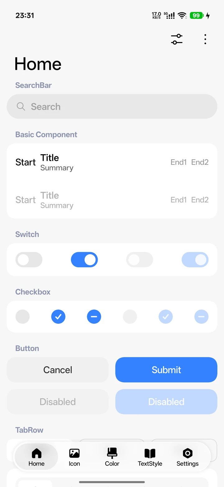</a><!--
--><a href="assets/light/002.webp">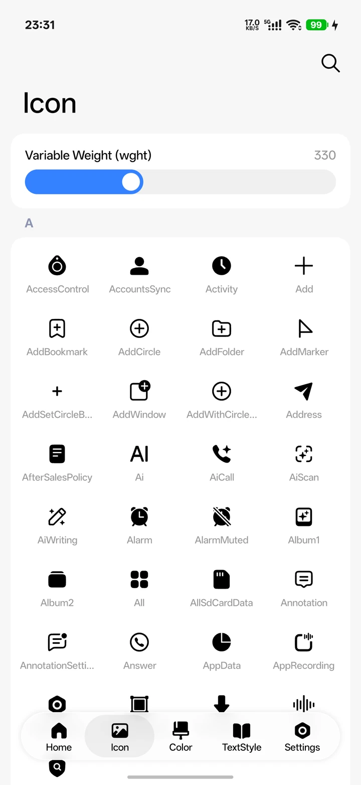</a><!--
--><a href="assets/light/003.webp">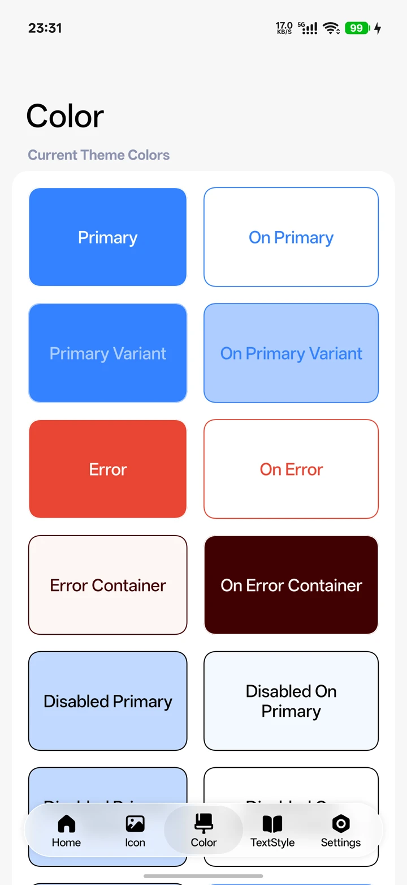</a><!--
--><a href="assets/light/004.webp">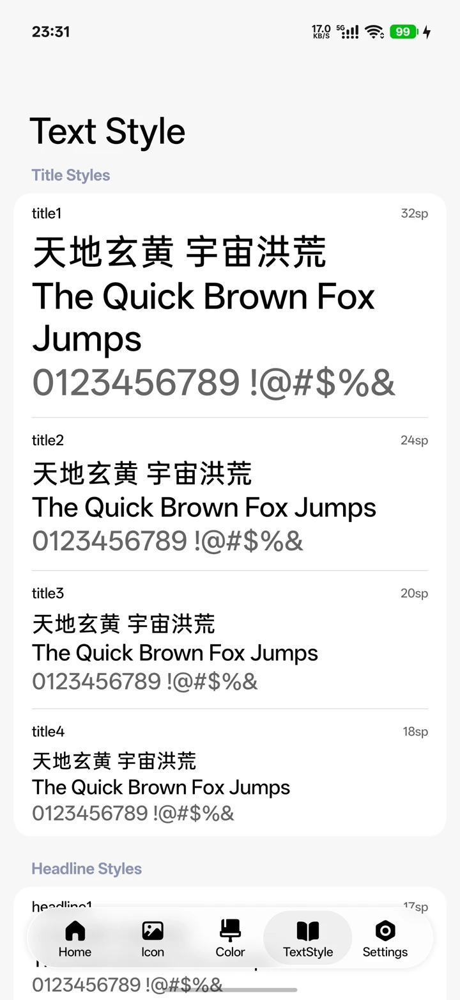</a><!--
--><a href="assets/light/005.webp">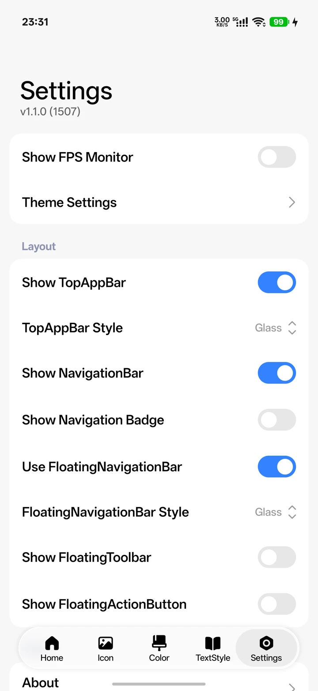</a><!--
--><a href="assets/light/006.webp">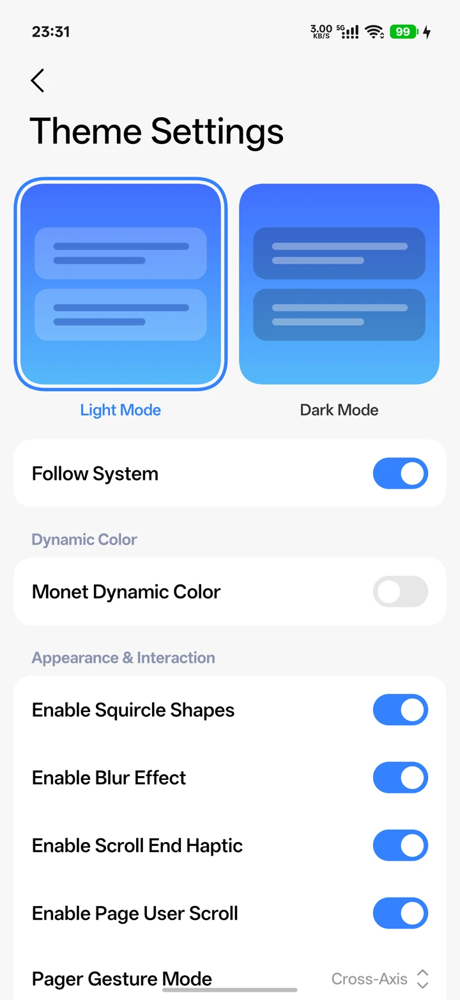</a><!--
--><a href="assets/light/007.webp">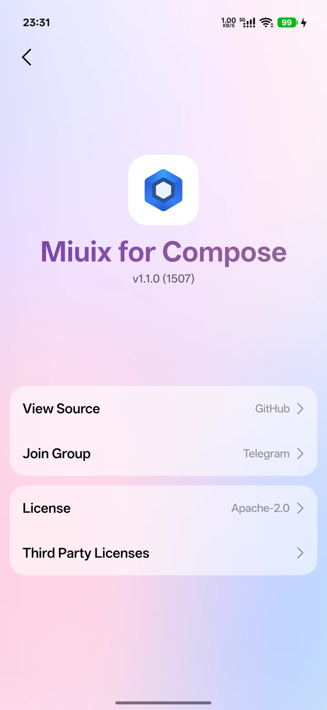</a><br><!--
--><a href="assets/dark/001.webp">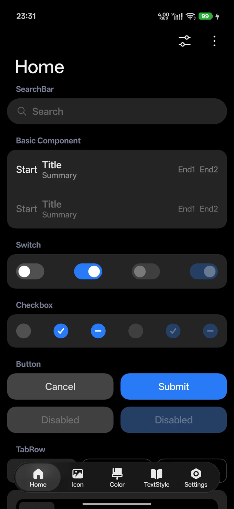</a><!--
--><a href="assets/dark/002.webp">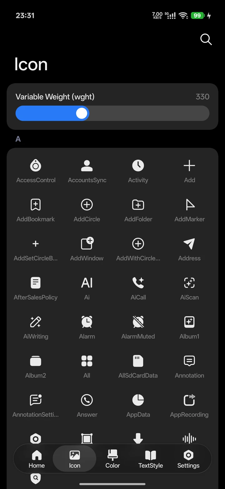</a><!--
--><a href="assets/dark/003.webp">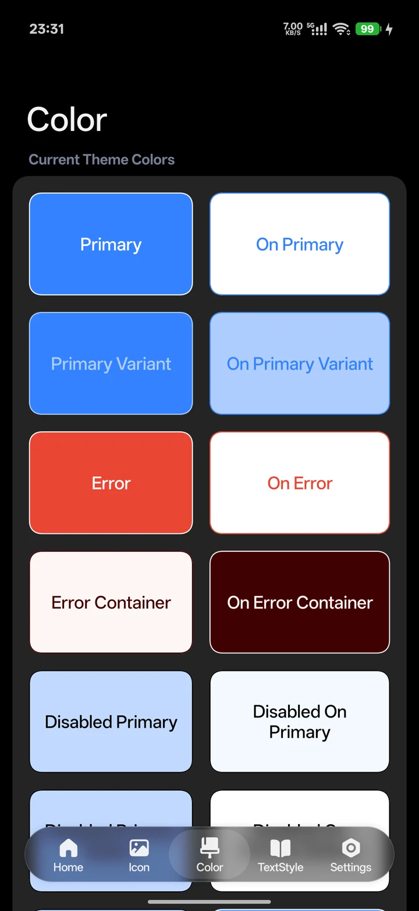</a><!--
--><a href="assets/dark/004.webp">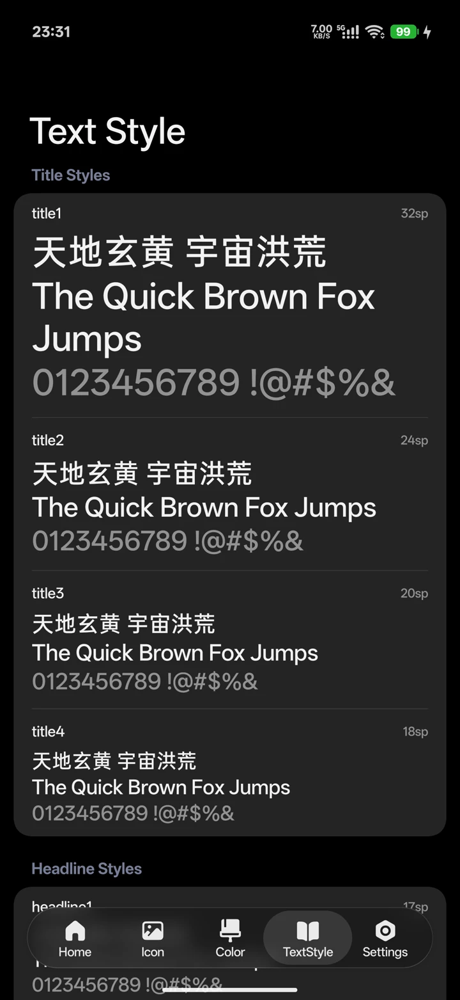</a><!--
--><a href="assets/dark/005.webp">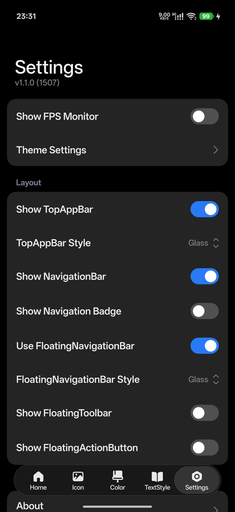</a><!--
--><a href="assets/dark/006.webp">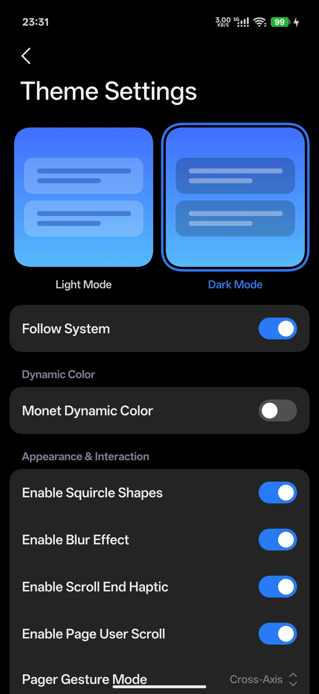</a><!--
--><a href="assets/dark/007.webp">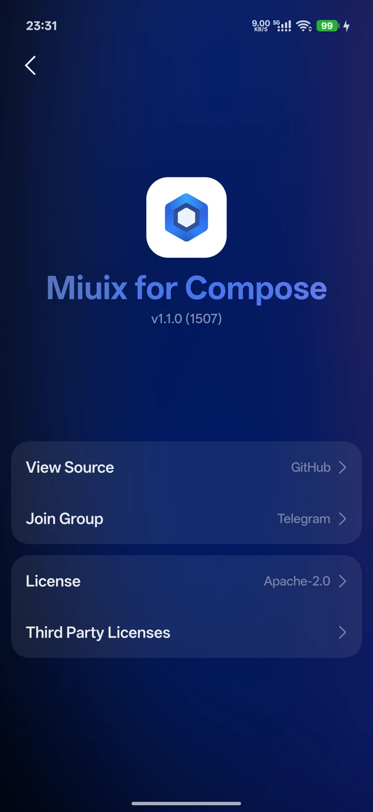</a>
</p>
